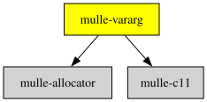

# mulle-vararg

#### ⏪ Access variable arguments in struct layout fashion in C

A variable argument passing scheme written in C (C11). It's an alternative
to
[stdarg](//en.wikipedia.org/wiki/Stdarg.h) or
[varargs](//pubs.opengroup.org/onlinepubs/7908799/xsh/varargs.h.html),
but not compatible with either.


| Release Version                                       | Release Notes  | AI Documentation
|-------------------------------------------------------|----------------|---------------
|      [](//github.com/mulle-c/mulle-vararg/actions) | [RELEASENOTES](RELEASENOTES.md) | [DeepWiki for mulle-vararg](https://deepwiki.com/mulle-c/mulle-vararg)


## API

There is an API to access mulle-vararg arguments. You can also build up
a mulle-vararg manually with the builder functions.

* [Vararg](dox/API_VARARG.md)
* [VarargBuilder](dox/API_VARARG_BUILDER.md)


## Documentation & Guides

* [API Summary](asset/dox/api/toc)


## How it works

**mulle-vararg** assumes that the arguments are not layed out in stack
alignment fashion but like in a struct. The C promotion rules are still
observed though.

> Remember the C argument promotion rules are
>
> 1. char and short to int/unsigned int
> 2. float to double
>

Let's assume there is a compiler that uses **mulle-vararg** for variable
arguments. It collects **all** function parameters and packs them into a struct,
then passes this struct to the function.

A **printf** function being being called like this:

``` c
printf( "%d %f %lld\n", (char) 'x', (float) 0.2, 1848LL;
```

would get its arguments embedded in a struct like this

``` c
struct
{
   char    *format;
   struct
   {
      int         value1;     // standard char -> int promotion
      double      value2;     // standard float -> double promotion
      long long   value3;
   } varargs;
} _param;
```

**mulle-vararg** provides the necessary functions to read such a struct. It has
some experimental code to write to it.

#### Advantages

* Easy to write in C, does not need compiler ABI internals to construct or
read. You don't need [libffi](//sourceware.org/libffi/) or some such.
* Cheap forwarding to other functions.

#### Disadvantages

* Not compatible with `<stdarg.h>`

### You are here




## Add

### Add mulle-vararg via mulle-core

mulle-vararg is a component of the
[mulle-core](//github.com/mulle-core/mulle-core) library.
In your code include its umbrella header:

``` c
#include <mulle-core/mulle-core.h>
```

Add mulle-core to your `CMakeLists.txt` with
[FetchContent](https://cmake.org/cmake/help/latest/module/FetchContent.html):

``` cmake
include( FetchContent)

set( MULLE__CORE_TAG "master" CACHE STRING "branch or tag to fetch mulle-core from")

FetchContent_Declare( MULLE__CORE
   GIT_REPOSITORY https://github.com/mulle-core/mulle-core.git
   GIT_TAG        "${MULLE__CORE_TAG}")
FetchContent_MakeAvailable( MULLE__CORE)

target_link_libraries( ${PROJECT_NAME} PUBLIC mulle-core)
```

Or add to your mulle-sde project with:

``` sh
mulle-sde add mulle-core/mulle-core
```


### Add mulle-vararg as a cmake subproject

In your code include its header:

``` c
#include <mulle-vararg/mulle-vararg.h>
```

Add mulle-vararg and its dependencies to your `CMakeLists.txt` with
[FetchContent](https://cmake.org/cmake/help/latest/module/FetchContent.html):

``` cmake
include( FetchContent)

include_directories( SYSTEM "${CMAKE_BINARY_DIR}/include")

set( MULLE__C11_TAG "master" CACHE STRING "branch or tag to fetch mulle-c11 from")

FetchContent_Declare( MULLE__C11
   GIT_REPOSITORY https://github.com/mulle-c/mulle-c11.git
   GIT_TAG        "${MULLE__C11_TAG}")
FetchContent_MakeAvailable( MULLE__C11)

set( MULLE__ALLOCATOR_TAG "master" CACHE STRING "branch or tag to fetch mulle-allocator from")

FetchContent_Declare( MULLE__ALLOCATOR
   GIT_REPOSITORY https://github.com/mulle-c/mulle-allocator.git
   GIT_TAG        "${MULLE__ALLOCATOR_TAG}")
FetchContent_MakeAvailable( MULLE__ALLOCATOR)

set( MULLE__VARARG_TAG "master" CACHE STRING "branch or tag to fetch mulle-vararg from")

FetchContent_Declare( MULLE__VARARG
   GIT_REPOSITORY https://github.com/mulle-c/mulle-vararg.git
   GIT_TAG        "${MULLE__VARARG_TAG}")
FetchContent_MakeAvailable( MULLE__VARARG)

target_link_libraries( ${PROJECT_NAME} PUBLIC mulle-vararg)
```

Or add to your mulle-sde project with:

``` sh
mulle-sde add github:mulle-c/mulle-vararg
```

## Individual Install

Install all the prerequisites.

``` bash
PREFIX=/tmp/usr/local
BUILD_DIR="mulle-vararg/build"

cmake -S "mulle-vararg" -B "${BUILD_DIR}"    \
  -DCMAKE_BUILD_TYPE="Release"                  \
  -DCMAKE_INSTALL_PREFIX="${PREFIX}"            \
  -DCMAKE_PREFIX_PATH="${PREFIX}"               \
  -DCMAKE_C_FLAGS="-I"${PREFIX}"/include"       \
&& cmake --build "${BUILD_DIR}"  --parallel     \
&& cmake --install "${BUILD_DIR}"
```


## Author

[Nat!](https://mulle-kybernetik.com/weblog) for Mulle kybernetiK  


